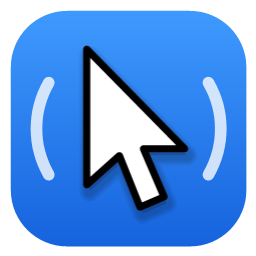
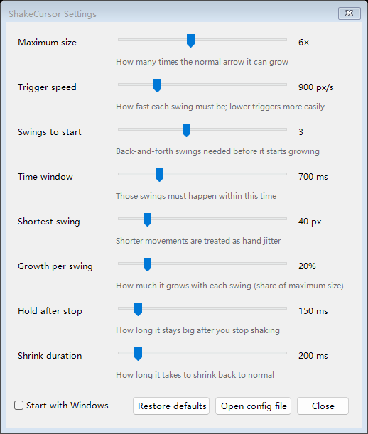

  

<h1 align="center">ShakeCursor</h1>

  Shake the mouse to find your cursor on Windows, just like on macOS. 
  <a href="https://github.com/yiyisheh/ShakeCursor/releases/latest"><b>Download</b></a> ·
  <b>English</b> · <a href="README.zh-CN.md">简体中文</a>

---

Lost the pointer on a big screen or across several monitors? Give the mouse a quick shake and the cursor grows so you can spot it right away. Stop shaking and it shrinks back.

## Features

- **Instant**: the cursor grows smoothly while you shake and shrinks back as soon as you stop.
- **Won't get in your way**: quick everyday moves, circles and dragging don't set it off.
- **Lightweight**: a single 84 KB program that uses almost no CPU while idle and needs nothing else installed.
- **Sharp on any display**: starts from your current cursor size and stays crisp at any scaling.
- **Adjustable**: change the size, sensitivity and timing with live sliders while you shake.
- **Speaks your language**: English, 简体中文, 繁體中文 and 日本語.

  

## Download

Get the latest version from [Releases](https://github.com/yiyisheh/ShakeCursor/releases/latest):

- **ShakeCursor.msi**: installer (recommended). Installs for all users, adds a Start menu entry and starts with Windows.
- **ShakeCursor.exe**: portable version. Just run it.

Works on Windows 10 (version 1903 or later) and Windows 11.

## Usage

ShakeCursor runs quietly in the notification area. Right-click its icon to pause it, open the settings, or choose whether it starts with Windows. Double-click the icon to open the settings.

## FAQ

**Windows says "Windows protected your PC".**
ShakeCursor isn't code-signed yet. Click **More info → Run anyway**.

**Can I turn off starting with Windows?**
Yes. Untick **Start with Windows** in the tray menu or in the settings. Each user on the PC can choose this for themselves.

**Where are my settings stored?**
In `%APPDATA%\ShakeCursor\config.json`.

**How do I uninstall it?**
Go to **Settings → Apps** and uninstall ShakeCursor. If you use the portable version, choose **Exit** and delete the file.

## Code signing

Free code signing provided by [SignPath.io](https://about.signpath.io/), certificate by [SignPath Foundation](https://signpath.org/). See the [code signing policy](CODE_SIGNING.md).

## License

[MIT](LICENSE) © yiyisheh
