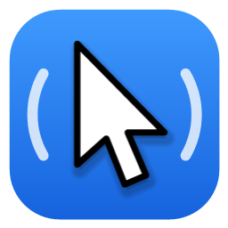
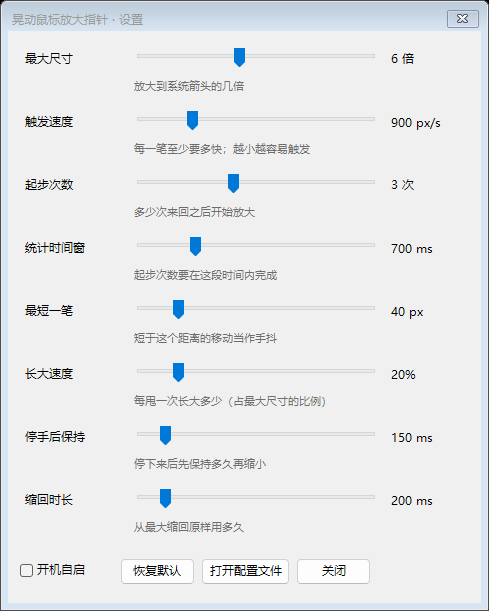

  

<h1 align="center">ShakeCursor</h1>

  在 Windows 上晃一晃鼠标就能找到指针，和 macOS 一样。 
  <a href="https://github.com/yiyisheh/ShakeCursor/releases/latest"><b>下载</b></a> ·
  <a href="README.md">English</a> · <b>简体中文</b>

---

大屏或多显示器上找不到鼠标指针？快速晃几下鼠标，指针就会变大，一眼就能看到；停下来，它就缩回原样。

## 特点

- **跟手**：晃的时候平滑变大，一停下就缩回。
- **不打扰**：平时的快速移动、画圈、拖拽，都不会误触发。
- **轻巧**：只有一个 84 KB 的程序，空闲时几乎不占 CPU，也不用另外安装任何东西。
- **清晰**：从你当前的指针大小开始放大，任何缩放比例下都很清晰。
- **可调**：大小、灵敏度、快慢都能用滑块调，可以边晃边调。
- **多语言**：English、简体中文、繁體中文、日本語。

  

## 下载

从 [Releases](https://github.com/yiyisheh/ShakeCursor/releases/latest) 下载最新版本：

- **ShakeCursor.msi**：安装包（推荐）。为所有用户安装，带开始菜单入口，开机自动启动。
- **ShakeCursor.exe**：便携版，直接运行。

支持 Windows 10（1903 及以上版本）和 Windows 11。

## 使用

ShakeCursor 安静地待在任务栏通知区域。右键图标可以暂停、打开设置、选择是否开机启动；双击图标也能打开设置。

## 常见问题

**Windows 提示“Windows 已保护你的电脑”。**
ShakeCursor 暂时没有代码签名。点 **更多信息 → 仍要运行** 即可。

**能关掉开机启动吗？**
可以。在托盘菜单或设置里取消勾选 **开机自启**。电脑上的每个用户可以各自选择。

**设置保存在哪里？**
在 `%APPDATA%\ShakeCursor\config.json`。

**怎么卸载？**
在 **设置 → 应用** 里卸载 ShakeCursor。如果用的是便携版，在托盘菜单里选 **退出**，然后删掉文件即可。

## 代码签名

免费代码签名由 [SignPath.io](https://about.signpath.io/) 提供，证书由 [SignPath Foundation](https://signpath.org/) 签发。详见[代码签名政策](CODE_SIGNING.md)。

## 许可证

[MIT](LICENSE) © yiyisheh
